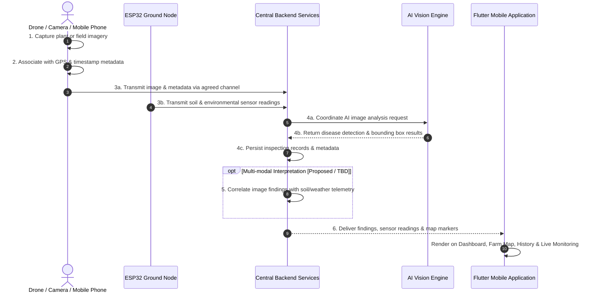

# 03. High-Level System Flow & Architectural Boundaries

> **Status**: Draft – Derived from Source File  
> **Module**: PRD / Product Overview  
> **Source Reference**: `Source File.docx` (§2, §5)

---

## 1. End-to-End Operational Flow `[Confirmed]` (Source: §2)

The AgroScout AI operational lifecycle proceeds through six discrete, coordinated stages:

1. **Stage 1 (Image Capture)**: A drone, external camera, or mobile device captures plant or field imagery `(Source: §2)`.
2. **Stage 2 (Metadata Tagging)**: The captured image is associated with available geographic location (GPS) and capture-time metadata `(Source: §2)`.
3. **Stage 3 (Ingestion & Transmission)**: Images and IoT sensor readings are transmitted through agreed communication channels to the Central Backend `(Source: §2)`.
4. **Stage 4 (Centralized Analysis & Storage)**: The Backend coordinates AI image analysis (executing pathogen classification and bounding box localization where supported) and securely stores the resulting inspection records `(Source: §2)`.
5. **Stage 5 (Sensor Interpretation)**: Where agreed by the engineering team, image findings can be interpreted alongside ambient and soil sensor readings (e.g., correlating high humidity with fungal risks) `(Source: §2)`.
6. **Stage 6 (Client Presentation)**: The Flutter mobile application retrieves and displays detections, sensor telemetry, and location-linked findings on executive dashboards, historical audit screens, and the interactive farm map `(Source: §2)`.

---

## 2. Architectural Scope Boundaries & Invariants `[Confirmed]` (Source: §2, §5)

To prevent architectural deviation, the following invariants are formally defined:

- **Centralized Backend Inference `[Confirmed]`**: Disease detection is architected as a **Backend-based processing pipeline** in the baseline specification. On-device local inference (e.g., edge TFLite on mobile) is **not** the primary path `(Source: §2, §5)`.
- **Asynchronous Offline Behavior `[Confirmed]`**: When capturing images offline, the mobile client preserves images and metadata locally. However, **new AI disease results are not available for an offline image until that image is successfully uploaded to the Backend and processed** `(Source: §3 F6)`.
- **Architecture Boundaries Under Confirmation `[TBD]`**:
  - The exact camera transmission pipeline (direct Wi-Fi/cellular vs local intermediate bridge) remains to be confirmed `(Source: §2)`.
  - The drone integration method and level of telemetry coupling remain to be confirmed `(Source: §2)`.
  - The exact sensor-fusion algorithm combining IoT readings with visual inferences remains to be confirmed `(Source: §2)`.
  - The final device-to-backend communication protocol (HTTP vs MQTT) remains to be confirmed `(Source: §2, §5)`.
