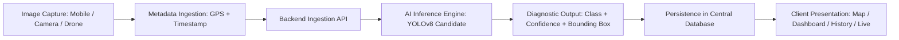

# Cross-Cutting Capability: Crop Disease Detection Pipeline

> **Status**: Draft – Derived from Source File  
> **Module**: Functional Requirements / Core Capabilities (AI Vision)  
> **Source Reference**: `Source File.docx` (§1, §2, §3 F3/F4/F6/F11/F12, §5, §7)

---

## 1. Capability Overview `[Confirmed]` (Source: §1, §2)

Plant disease detection is a cross-cutting capability spanning optical image ingestion, backend inference coordination, bounding-box localization, and multi-screen client rendering. It provides the core intelligence for Live Monitoring `(§3 F3)`, History & Details `(§3 F4)`, Offline Synchronization `(§3 F6)`, Image Submission `(§3 F11)`, and the AI Agricultural Advisor `(§3 F12)`.

---

## 2. Capability Pipeline Architecture `[Confirmed]` (Source: §2, §5)

---

## 3. Detailed Capability Requirements `[Confirmed / TBD]` (Source: §2, §3, §5, §7)

### CAP-AI-01: Centralized Backend-Based Inference Pipeline `[Confirmed]` (Source: §2, §5)
- **Requirement Statement**: The disease detection engine shall execute centrally on the Central Backend. Edge devices (mobile phones and ground cameras) capture and transmit images to the Backend for inference coordination; on-device neural network execution (e.g., local TFLite) is not the primary operational path.
- **Rationale**: Reduces client mobile hardware constraints, prevents device overheating/battery depletion, and centralizes model versioning and weight updates.
- **Verification**: Code inspection and network tracing confirming image inference executes via backend API requests.

### CAP-AI-02: Visual Pattern Recognition & Pathogen Identification `[Confirmed]` (Source: §1, §5)
- **Requirement Statement**: The AI vision pipeline shall analyze submitted foliage imagery to identify visual patterns associated with plant diseases and output a diagnosed disease label and numerical confidence score.
- **Rationale**: Provides objective, machine-assisted disease diagnosis to overcome the inconsistencies of non-specialist visual scouting.
- **Verification**: Run standardized validation dataset through the inference pipeline; assert output of pathogen class and confidence value.

### CAP-AI-03: Object Localization & Bounding Boxes `[Confirmed / Contingent]` (Source: §5)
- **Requirement Statement**: Where supported by the selected AI model architecture (such as the YOLOv8 candidate under evaluation), the pipeline shall generate spatial bounding box coordinates localizing the exact infected leaf regions within the photo.
- **Rationale**: Bounding boxes direct the farmer's attention to the specific visual symptoms on the leaf, enhancing interpretability and trust.
- **Verification**: Inspect backend API response payload to verify presence of normalized bounding box coordinates `[x_min, y_min, x_max, y_max]`.

### CAP-AI-04: Cross-Module Output Distribution `[Confirmed]` (Source: §3)
- **Requirement Statement**: The verified diagnosis (image, disease name, confidence score, bounding boxes, and timestamp) shall be distributed across the platform:
  - Pinned to the **Dashboard** as high-priority alerts `(Source: §3 F1)`.
  - Plotted as interactive pins on the **Farm Map** `(Source: §3 F2)`.
  - Displayed in **Live Monitoring** feeds `(Source: §3 F3)`.
  - Indexed in **History & Details** for longitudinal filtering `(Source: §3 F4)`.
  - Embedded in **Export Reports** as printable PDF exhibits `(Source: §3 F9)`.
- **Rationale**: Guarantees consistent diagnostic state across all mobile presentation layers.
- **Verification**: Submit a single test image and verify identical finding metadata renders across Dashboard, Map, History, and Reports.

### CAP-AI-05: Unconfirmed Model Architecture Boundaries `[TBD]` (Source: §5, §7)
- **Requirement Statement**: The final AI model selection, target crop varieties, specific pathogen taxonomy classes, training datasets, and validation accuracy targets remain open decisions subject to experimental testing by the AI team (YOLOv8 is an active example candidate).
- **Rationale**: Maintains architectural flexibility while experimental model benchmarking is conducted.
- **Verification**: Review against Section 7 items in `open-questions.md`.
